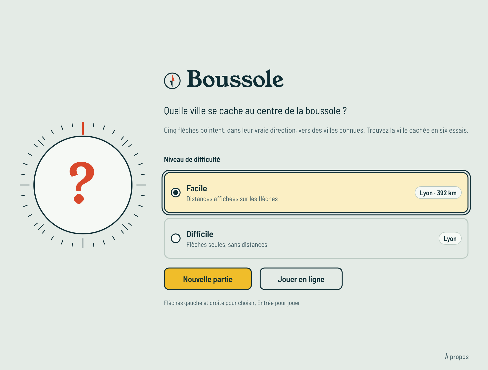
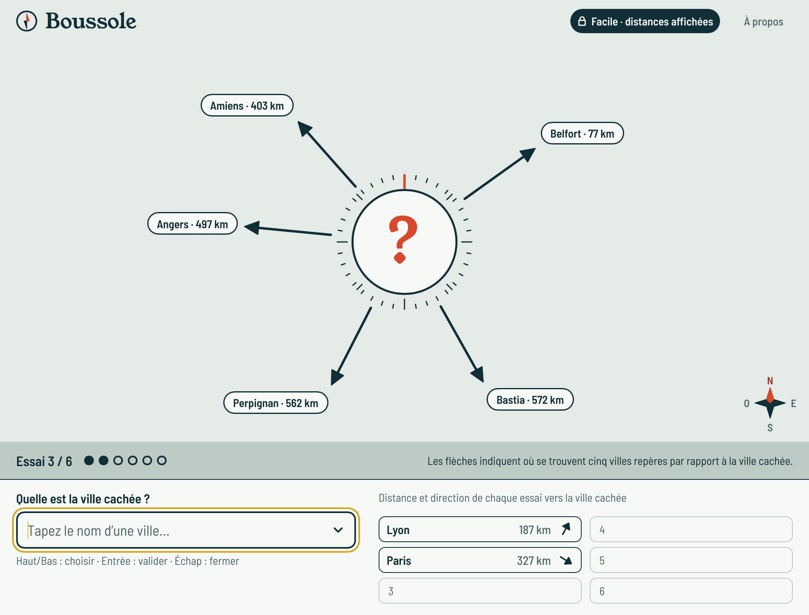
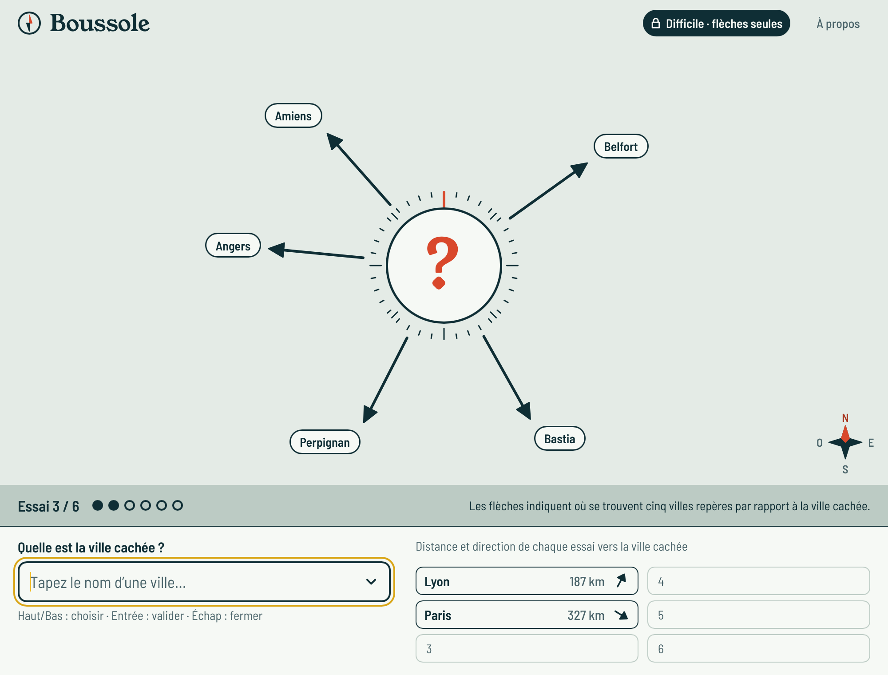
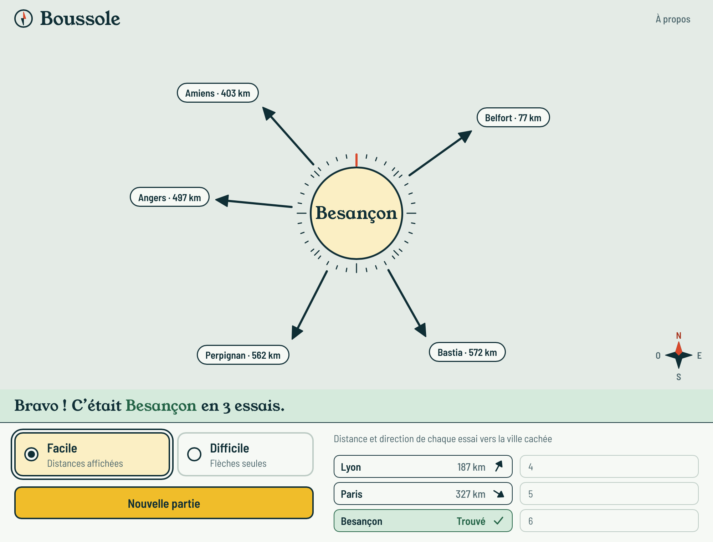
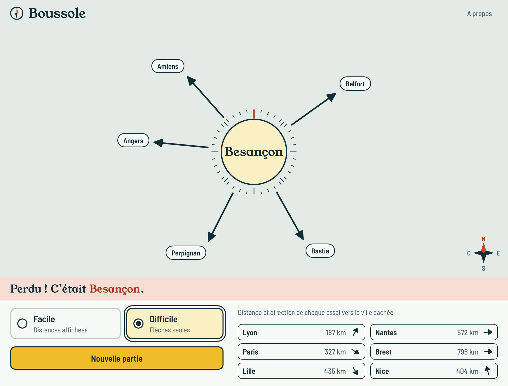
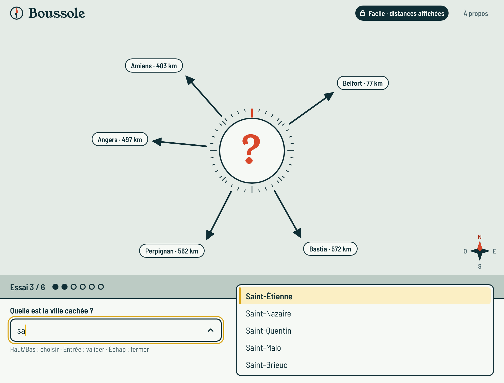
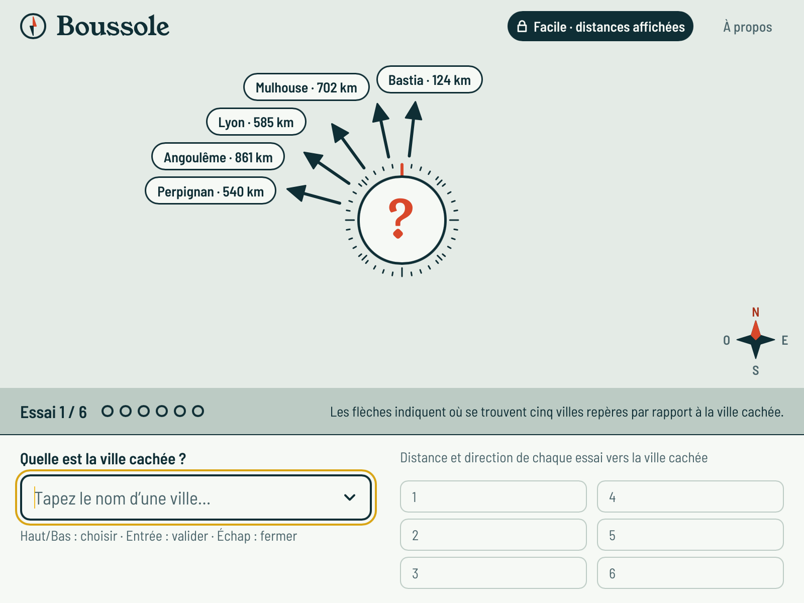

# Boussole — jeu de devinette de villes françaises

A desktop game written in Rust with [Slint](https://slint.dev). The game secretly picks a
French city and shows it as a **?** in the middle of a compass dial. Five arrows leave the dial
in the true compass direction of five well-known cities. Type your guesses (with autocomplete):
each wrong guess tells you how far, and in which direction, the hidden city is. You get six
tries. The interface is in French.



## Difficulty levels

The level is chosen **before each round** and is locked while the round runs (it is shown as a
badge in the header). The last choice is remembered for the session.

| Level | Arrow labels | Example |
|---|---|---|
| **Facile** — distances affichées | city name and distance, rounded to the km | `Lyon · 392 km` |
| **Difficile** — flèches seules | city name only | `Lyon` |

The guess history (distance and direction from your guess to the hidden city) is shown at both
levels.

| Facile | Difficile |
|---|---|
|  |  |

Same secret, same seed: only the labels differ. Arrow length never encodes the distance.

## Run

```sh
cargo run --release              # random games
cargo run --release -- --seed 42 # reproducible games: round k of the session uses seed 42 + k
```

Needs a recent stable Rust toolchain. Slint is built with its default winit backend and the
FemtoVG renderer; Qt is **not** required (the `fluent` std-widgets style is pinned in
`build.rs`). The first build compiles many crates and takes a few minutes.

## How to play

1. Pick **Facile** or **Difficile**, then **Nouvelle partie**.
2. Read the arrows: each one points from the hidden city towards a labelled city. The small
   compass in the corner gives the orientation (N is up).
3. Type a city name. Suggestions appear to the right of the field (in the history's place, so
   the arrows stay visible); pick one.
4. After each guess, the history shows the distance and an arrow pointing from your guess
   towards the hidden city. Find it within six tries.
5. At the end the dial reveals the city. Choose a level and start again.

A name that is not in the list is refused, and a city you already tried is refused without
costing a try.

### Keyboard and mouse

Everything can be done with the keyboard alone, or with the mouse alone.

| Where | Keyboard | Mouse |
|---|---|---|
| Start / between rounds | `←` `→` choose the level, `Enter` starts, `Tab` reaches the button | click a level, click **Nouvelle partie** |
| Guess field | type, `↑` `↓` move in the suggestions, `Enter` submits the highlighted one (or the exact name), `Esc` closes the list, `Esc` again empties the field, `↓` on an empty field lists every city | click a suggestion; the chevron on the right of the field lists every city (scroll with the wheel) |

A held `Enter` never starts a round, and `Enter` is ignored for a moment after the result
appears, so the *Bravo !* / *Perdu !* screen cannot be skipped by accident.

## Screenshots

All of them are produced by the real `.slint` UI rendered headlessly, with fixed secrets and
seeds (`cargo run --release --example screenshots`, see below).

| End of round (win) | End of round (loss) |
|---|---|
|  |  |

| Autocomplete (the board stays readable) | Tightest board: Porto-Vecchio at 800 × 600 |
|---|---|
|  |  |

More in [`docs/screenshots/`](docs/screenshots): start screen at the minimum size, the list of
every city, autocomplete at 800 × 600, the duplicate-guess notice, Facile at 800 × 600, the
*À propos* box.

## Project layout

- `src/` — the library `boussole`:
  - **core, no GUI types:** `cities` (embedded dataset of 120 cities), `geo` (distance,
    bearing, compass), `search` (name normalization and autocomplete), `game` (difficulty,
    hints, rounds, guesses);
  - **presentation logic, still GUI-free and unit-tested:** `board` (arrow and label geometry,
    French texts), `session` (Setup → Playing → Ended state machine, autocomplete state),
    `text` (label measurement with the embedded font);
  - **Slint glue:** `app` (a `Session` behind the window) and `headless` (a window without a
    screen, for screenshots and UI tests).
- `src/main.rs` — the game; `examples/` — `screenshots`, `real_window` (smoke test of the real
  winit window), `sample_round` (prints a round to the terminal, `cargo run --example
  sample_round -- 42 --reveal`).
- `ui/*.slint` — the interface: `theme` (palette, fonts), `types`, `widgets` (buttons, level
  picker, dial, compass rose), `board`, `guess` (input, suggestions, history), `app`.
  `ui/fonts/` holds the two embedded fonts and their licences.
- `tests/` — `board_layout` (geometry over every secret and several window sizes), `ui_flow`
  (whole rounds played through the real UI).

## Tests and quality gate

```sh
cargo test                   # unit tests, layout sweeps, end-to-end UI tests
cargo test --lib board::     # one module

# full gate, must be green before merging:
cargo fmt --check && cargo clippy --all-targets -- -D warnings && cargo test && cargo build --release

cargo run --release --example screenshots   # regenerate docs/screenshots/
cargo run --release --example real_window -- /tmp/real  # opens the real window for ~2 s
```

The UI tests run without a display: `boussole::headless` installs a Slint platform backed by the
software renderer, injects key presses and clicks, and renders to memory. Mouse targets are
found through accessible labels (the tests use Slint's `i-slint-backend-testing` element
lookup, which is why `build.rs` enables debug info).

## Hint rules (see `src/game.rs`)

Each round has exactly 5 hints from the `reference` cities, never the secret, 50–700 km away,
with bearings at least 40° apart (35° minimum, sorted clockwise). Secrets on the edge of France
(Ajaccio, Bastia, Porto-Vecchio, Brest, Quimper, Calais, Dunkerque, Strasbourg, Bayonne) have
all their neighbours in a narrow sector, so the spread and/or distance window is relaxed
deterministically (down to 15° and 1 000 km for Porto-Vecchio); the exact floors are documented
and tested in `game::tests::RELAXED`. The board layout (`src/board.rs`) keeps every label
readable and inside the canvas down to a 15° gap: arrow *directions* are always exact, only a
label may slide aside along the circle to make room for its neighbour.

## Licences

- **Slint** is used under the **Royalty-Free Desktop, Mobile and Web Applications License**
  (Slint is also available under GPLv3 and a commercial licence). The licence asks for an
  attribution: the *À propos* box (button at the top right) shows Slint's `AboutSlint` badge.
- Fonts, embedded in the binary: **Young Serif** (titles and the dial) and **Barlow Semi
  Condensed** (everything else), both under the SIL Open Font License 1.1 — see
  `ui/fonts/OFL-*.txt`.
- "Boussole" is an original name and look; the game only borrows the *mechanic* of arrows
  pointing towards known cities.
