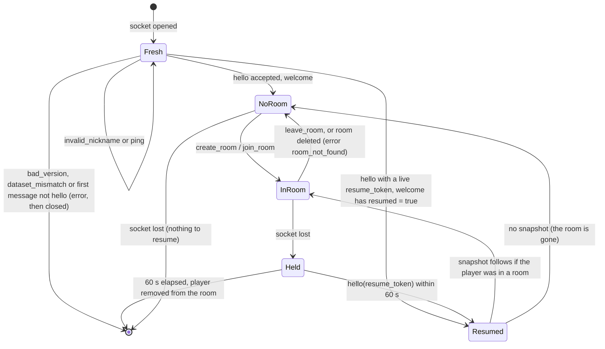
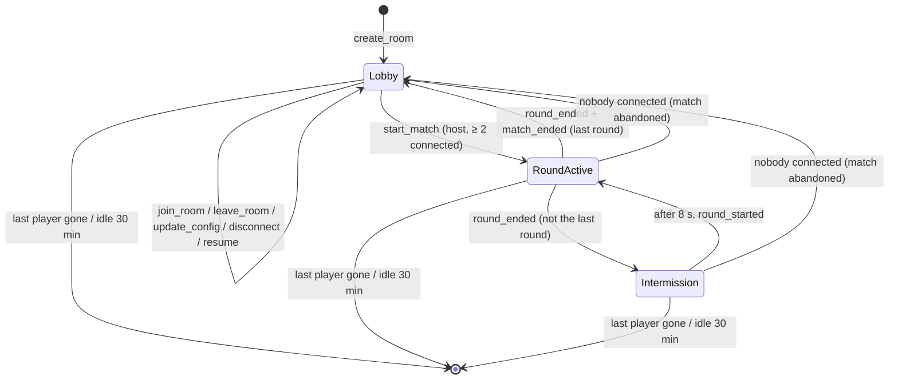
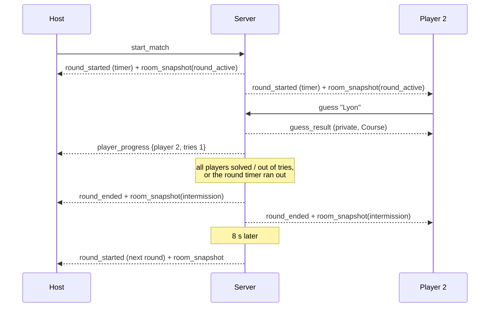

# Boussole multiplayer protocol (version 1)

This document, the `boussole-protocol` crate and the golden JSON fixtures in
`crates/boussole-protocol/tests/fixtures/` are the **source of truth** for the server
(`boussole-server`) and the client. Every JSON example below is a fixture quoted verbatim;
a test fails if the two drift apart. The rules are implemented, with tests, by the pure engine
in `crates/boussole-server/src/engine/`.

- [1. Transport](#1-transport)
- [2. Conventions](#2-conventions)
- [3. Connection and handshake](#3-connection-and-handshake)
- [4. Rooms](#4-rooms)
- [5. Client → server messages](#5-client--server-messages)
- [6. Server → client messages](#6-server--client-messages)
- [7. Rounds and match flow](#7-rounds-and-match-flow)
- [8. Timers](#8-timers)
- [9. Scoring](#9-scoring)
- [10. Disconnection and resume](#10-disconnection-and-resume)
- [11. Errors](#11-errors)
- [12. Versioning and dataset](#12-versioning-and-dataset)
- [13. Secret safety](#13-secret-safety)
- [14. Notes for the server transport (04)](#14-notes-for-the-server-transport-04)
- [15. Notes for the client (05)](#15-notes-for-the-client-05)
- [16. Clarifications and deviations from ticket 03](#16-clarifications-and-deviations-from-ticket-03)

## 1. Transport

- WebSocket, path `/ws`, **text frames only**, one JSON object per frame, UTF-8.
  (Binary frames are a protocol error; the transport answers `bad_message`.)
- Every object has a `"type"` field (snake_case) selecting the message; all other fields are
  snake_case. **Unknown fields are ignored**; an unknown `type`, a missing or mistyped field or
  invalid JSON is `bad_message` (the connection is kept).
- Client → server frames are limited to **4096 bytes** (`MAX_FRAME_BYTES`). A longer frame is
  answered with `bad_message` and the connection is closed. Server → client frames stay far
  below 64 KiB (`MAX_SERVER_FRAME_BYTES`, the cap a client should accept); the largest real
  frames are a `round_ended` for 8 players with 6 long city names each (about 3.3 KB) and an
  intermission `room_snapshot` embedding it (about 5 KB).
- The Rust types are `boussole_protocol::{ClientMsg, ServerMsg}`; `encode`, `decode_server`,
  `encode_client` and `decode_client` are the codec. `decode_client` rejects oversized input
  before parsing and never panics.

## 2. Conventions

| Thing | Rule |
|---|---|
| `player_id` | `u32` assigned by the server at `hello`; unique on the server and **stable across reconnections** (a resumed player keeps it). |
| Room code | 5 characters from `ABCDEFGHJKLMNPQRSTUVWXYZ23456789` (no `I O 0 1`), unique among live rooms. Joining is case-insensitive and ignores surrounding spaces. |
| Nickname | Trimmed; 1–16 Unicode scalar values; no control character. Unique **case-insensitively** (Unicode lowercase) inside a room. |
| City names | The exact names of `boussole_core::cities::CITIES` (`"Saint-Étienne"`). A guess is matched with `boussole_core::search::find_exact`, which ignores case and accents (`"saint-etienne"` is accepted), and results always carry the canonical spelling. |
| Distances | Whole kilometres (rounded to nearest) in every message, as `u32`. |
| Bearings | Degrees clockwise from north in `[0, 360)`, rounded to 0.1°. **Hints:** from the secret *to* the hint city. **Guess results:** from the guess *to* the secret. |
| Time | The server never sends clocks. Durations are `…_ms` / `…_s` integers; a **`remaining_ms` is the time left at the moment the server built the message**. A client computes `deadline = receive_time + remaining_ms` on its own monotonic clock and counts down locally; the server's clock is authoritative and a guess that arrives after the deadline is refused. |
| Hello hex fields | `dataset_fingerprint`: 16 lowercase hex digits (a string, never a JSON number). `resume_token`: 32 hex digits (128 random bits). |
| Optional fields | `distance_km` in a hint, `resume_token` in `hello`, `round`, `intermission` in a snapshot, `found_by` and `next_round_in_ms` in `round_ended` are **omitted** when absent (never `null`). |

## 3. Connection and handshake



1. The client opens the socket and sends **`hello` as its first message**. Only `ping` may
   precede it (answered with `pong`); any other message ends the connection with
   `invalid_state`.
2. The server checks, in this order: `protocol_version` (`bad_version`), `dataset_fingerprint`
   (`dataset_mismatch`) — both are followed by closing the connection — then the
   `resume_token`, then the nickname (`invalid_nickname`; the connection stays open and the
   client may send another `hello`).
3. A `resume_token` that belongs to a player whose slot is still held restores that player
   (§10): the `welcome` has `resumed: true`, the **nickname in this `hello` is ignored**, and a
   `room_snapshot` follows if the player is in a room. Any other token (unknown, expired,
   already forgotten) is silently treated as no token: a brand-new player is created and the
   `welcome` has `resumed: false`.
4. A second `hello` on an identified connection is `invalid_state` (nothing changes).

Example `hello`, first connection:

```json
{"type":"hello","protocol_version":1,"dataset_fingerprint":"9907ec8ae376fbf8","nickname":"Alice"}
```

`hello` carrying the token of a dropped session:

```json
{"type":"hello","protocol_version":1,"dataset_fingerprint":"9907ec8ae376fbf8","nickname":"Alice","resume_token":"3f9a1c5e7b2d4086a1b3c5d7e9f01234"}
```

`welcome` (keep `resume_token` secret and in memory or a private file; it is the session
credential):

```json
{"type":"welcome","player_id":1,"resume_token":"3f9a1c5e7b2d4086a1b3c5d7e9f01234","resumed":false}
```

## 4. Rooms



- **Create.** `create_room { config }` makes the sender the **host** and the only member;
  a `room_snapshot` follows. A player can be in one room at a time (`invalid_state`
  otherwise).
- **Configuration** (`RoomConfig`, host-chosen, validated on create and on update;
  out of range → `invalid_config`). Omitted numbers take their default; `mode` and
  `difficulty` are required.

  | Field | Values | Default |
  |---|---|---|
  | `mode` | `course` · `cooperation` | — |
  | `difficulty` | `facile` (hint distances sent) · `difficile` (no distances) | — |
  | `rounds` | 1–10 | 5 |
  | `max_players` | 2–8 | 8 |
  | `round_time_s` | 60–300 (Course) | 120 |
  | `turn_time_s` | 15–120 (Coopération) | 45 |

  All four numbers are range-checked whatever the mode. They are unsigned 32-bit on the wire,
  so `0` or `4000000000` is `invalid_config`, while `-1` or `1.5` is `bad_message`.
- **Join.** `join_room { code }`. Refused with `room_not_found` (no such room or malformed
  code), `match_in_progress` (the room is not in `Lobby`; there is no mid-match join),
  `room_full` (members, **including players whose socket is down but whose slot is held**,
  have reached `max_players`) or `nickname_taken`, checked in that order. Players are
  ordered by join time.
- **Leave.** `leave_room` at any time. The leaver gets no answer and is outside any room
  (still connected; they may create or join another). An empty room is deleted at once.
- **Update.** `update_config { config }`: host only (`not_host`), lobby only
  (`invalid_state`), valid (`invalid_config`) and with `max_players` not below the number of
  members (`invalid_config`). Everyone receives a `room_snapshot`.
- **Start.** `start_match`: host only (`not_host`), lobby only (`invalid_state`), at least 2
  **connected** players (`not_enough_players`). Scores are reset and round 1 starts.
- **Host transfer.** When the host leaves, is removed, **or loses their socket**, the next
  *connected* player in join order becomes host (if nobody else is connected, the host
  keeps the role until they are removed, then the next member in join order takes it). A host
  who resumes does not get the role back. The change is visible in the next snapshot
  (`players[].host`).
- **Deletion.** A room is deleted when its last member is gone, or when **no client message
  from any of its members** (a `ping` counts) arrives for 30 minutes. Connected members then
  receive `error { code: "room_not_found" }` and are room-less again.

## 5. Client → server messages

| `type` | Fields | Valid when | Errors |
|---|---|---|---|
| `hello` | `protocol_version`, `dataset_fingerprint`, `nickname`, `resume_token?` | first message | `bad_version`, `dataset_mismatch`, `invalid_nickname`, `invalid_state` |
| `create_room` | `config` | identified, no room | `invalid_config`, `invalid_state` |
| `join_room` | `code` | identified, no room | `room_not_found`, `match_in_progress`, `room_full`, `nickname_taken`, `invalid_state` |
| `leave_room` | — | in a room | `invalid_state` |
| `update_config` | `config` | host, lobby | `not_host`, `invalid_state`, `invalid_config` |
| `start_match` | — | host, lobby | `not_host`, `invalid_state`, `not_enough_players` |
| `guess` | `city` | round active (see §7) | `invalid_state`, `round_over`, `not_your_turn`, `unknown_city`, `already_guessed` |
| `ping` | — | any time, even before `hello` | — |

Any message may also draw `bad_message` (undecodable frame) or `rate_limited` (sent by the
transport only; the engine never emits it).

```json
{"type":"create_room","config":{"mode":"course","difficulty":"facile","rounds":3,"max_players":4,"round_time_s":90,"turn_time_s":45}}
```

```json
{"type":"join_room","code":"K7QX2"}
```

```json
{"type":"leave_room"}
```

```json
{"type":"update_config","config":{"mode":"cooperation","difficulty":"difficile","rounds":3,"max_players":4,"round_time_s":90,"turn_time_s":45}}
```

```json
{"type":"start_match"}
```

```json
{"type":"guess","city":"Saint-Étienne"}
```

```json
{"type":"ping"}
```

## 6. Server → client messages

### 6.1 Ordering and the snapshot rule

Every state change produces messages in **two layers**, always in this order for a given
connection within one server step (one received message, one disconnection or one timer):

1. direct replies, errors and **events** (`round_started`, `guess_result`, `player_progress`,
   `turn_changed`, `round_ended`, `match_ended`) in causal order;
2. **at most one `room_snapshot`** per room whose room-level state changed, describing the
   state *after* the step.

A `room_snapshot` is the **full state of the room for its receiver** and replaces whatever the
client knew. It is sent on: room creation, join, leave, host change, connect/disconnect/resume
of any member, configuration update, round start, round end, match end, abandonment of a
match, and when a player resumes (to that player too, with their round state). It is **not**
sent after a plain `guess_result`, `player_progress` or a `turn_changed` caused by a guess or a
timeout: those events carry everything needed. Events are applied on top of the last snapshot
and are always consistent with the next one.

### 6.2 `welcome`

See §3. `resumed: true` means the identity and slot were restored.

### 6.3 `room_snapshot`

```text
code, config, phase: lobby | round_active | intermission,
players: [{ id, nickname, host, connected, score }]   -- in join order
round?          present iff phase == round_active
intermission?   present iff phase == intermission
```

- `players[].score`: Course: the player's match total so far (updated at each round's end).
  Coopération: the team total (identical for everyone). Scores are kept after a match until the
  next `start_match`.
- `players[].connected` is `false` while a player's slot is held after a socket loss.
- `round` is the round as **this receiver** sees it:
  - `start`: the `round_started` data (round index, hints, max tries) with `timer` set to the
    *current* remaining time.
  - `guesses`: Course — the receiver's **own** guesses with feedback, in order. Coopération —
    the team's guesses, in order, each with its author (`by`).
  - `progress`: Course — one entry per player (tries used / solved / out of tries), no city
    names. Coopération — empty.
- `intermission`: `next_round_index`, `remaining_ms` until it starts, and `last_round`, the
  `round_ended` that opened the pause (its `next_round_in_ms` equals `remaining_ms`).
- In `lobby` after a match, neither `round` nor `intermission` is present.

Lobby:

```json
{"type":"room_snapshot","code":"K7QX2","config":{"mode":"course","difficulty":"facile","rounds":3,"max_players":4,"round_time_s":90,"turn_time_s":45},"phase":"lobby","players":[{"id":1,"nickname":"Alice","host":true,"connected":true,"score":0},{"id":2,"nickname":"Bob","host":false,"connected":false,"score":0}]}
```

Course round in progress, Difficile (Alice has made two guesses; `distance_km` is absent from
the hints but present in her guess feedback):

```json
{"type":"room_snapshot","code":"K7QX2","config":{"mode":"course","difficulty":"difficile","rounds":3,"max_players":4,"round_time_s":90,"turn_time_s":45},"phase":"round_active","players":[{"id":1,"nickname":"Alice","host":true,"connected":true,"score":0},{"id":2,"nickname":"Bob","host":false,"connected":false,"score":0}],"round":{"start":{"round_index":1,"total_rounds":3,"max_tries":6,"hints":[{"city":"Amiens","bearing_deg":330.5},{"city":"Belfort","bearing_deg":48.0},{"city":"Bastia","bearing_deg":128.5},{"city":"Perpignan","bearing_deg":201.0},{"city":"Angers","bearing_deg":275.5}],"timer":{"kind":"round","remaining_ms":71250}},"guesses":[{"by":1,"city":"Lyon","distance_km":163,"bearing_deg":24.5,"correct":false,"tries_used":1},{"by":1,"city":"Dijon","distance_km":76,"bearing_deg":112.0,"correct":false,"tries_used":2}],"progress":[{"player_id":1,"tries_used":2,"solved":false,"out_of_tries":false},{"player_id":2,"tries_used":1,"solved":false,"out_of_tries":false}]}}
```

Coopération round in progress (Bob holds the turn, 31 s left; the team already tried Lyon):

```json
{"type":"room_snapshot","code":"K7QX2","config":{"mode":"cooperation","difficulty":"facile","rounds":3,"max_players":4,"round_time_s":90,"turn_time_s":45},"phase":"round_active","players":[{"id":1,"nickname":"Alice","host":true,"connected":true,"score":600},{"id":2,"nickname":"Bob","host":false,"connected":true,"score":600}],"round":{"start":{"round_index":2,"total_rounds":3,"max_tries":6,"hints":[{"city":"Amiens","bearing_deg":330.5,"distance_km":403},{"city":"Belfort","bearing_deg":48.0,"distance_km":77},{"city":"Bastia","bearing_deg":128.5,"distance_km":572},{"city":"Perpignan","bearing_deg":201.0,"distance_km":562},{"city":"Angers","bearing_deg":275.5,"distance_km":497}],"timer":{"kind":"turn","player_id":2,"remaining_ms":31000}},"guesses":[{"by":1,"city":"Lyon","distance_km":215,"bearing_deg":201.5,"correct":false,"tries_used":1}],"progress":[]}}
```

Intermission (5.5 s left before round 2):

```json
{"type":"room_snapshot","code":"K7QX2","config":{"mode":"course","difficulty":"facile","rounds":3,"max_players":4,"round_time_s":90,"turn_time_s":45},"phase":"intermission","players":[{"id":1,"nickname":"Alice","host":true,"connected":true,"score":0},{"id":2,"nickname":"Bob","host":false,"connected":false,"score":0}],"intermission":{"next_round_index":2,"remaining_ms":5500,"last_round":{"round_index":1,"total_rounds":3,"secret":"Besançon","results":[{"player_id":1,"guesses":[{"city":"Lyon","distance_km":163},{"city":"Dijon","distance_km":76},{"city":"Besançon","distance_km":0}],"solved":true,"tries_used":3,"points":496,"total":496},{"player_id":2,"guesses":[{"city":"Paris","distance_km":327}],"solved":false,"tries_used":1,"points":0,"total":0}],"next_round_in_ms":5500}}}
```

### 6.4 `round_started`

Sent to every connected member when a round opens (followed by a snapshot).

- `hints`: exactly 5, sorted by bearing, never containing the secret. **`distance_km` is
  present only in `facile`; in `difficile` the key is omitted.**
- `max_tries`: always 6.
- `timer`: `{"kind":"round","remaining_ms":…}` in Course (time left in the round);
  `{"kind":"turn","player_id":…,"remaining_ms":…}` in Coopération (who plays first and the
  turn clock).

```json
{"type":"round_started","round_index":1,"total_rounds":3,"max_tries":6,"hints":[{"city":"Amiens","bearing_deg":330.5,"distance_km":403},{"city":"Belfort","bearing_deg":48.0,"distance_km":77},{"city":"Bastia","bearing_deg":128.5,"distance_km":572},{"city":"Perpignan","bearing_deg":201.0,"distance_km":562},{"city":"Angers","bearing_deg":275.5,"distance_km":497}],"timer":{"kind":"round","remaining_ms":90000}}
```

```json
{"type":"round_started","round_index":2,"total_rounds":3,"max_tries":6,"hints":[{"city":"Amiens","bearing_deg":330.5},{"city":"Belfort","bearing_deg":48.0},{"city":"Bastia","bearing_deg":128.5},{"city":"Perpignan","bearing_deg":201.0},{"city":"Angers","bearing_deg":275.5}],"timer":{"kind":"turn","player_id":2,"remaining_ms":45000}}
```

### 6.5 `guess_result`

An accepted guess. `distance_km` and `bearing_deg` go **from the guess to the secret** and are
sent in both difficulties. `by` is the guesser; `tries_used` counts tries after this guess
(Course: the guesser's own; Coopération: the team's). `correct` is true when the guess is the
secret.

- **Course:** sent **only to the guesser** (`by` is always the receiver).
- **Coopération:** broadcast to the whole room, guesser included.

```json
{"type":"guess_result","by":1,"city":"Lyon","distance_km":163,"bearing_deg":24.5,"correct":false,"tries_used":1}
```

### 6.6 `player_progress` (Course only)

Sent to every connected member **except the guesser** after each accepted guess, so everybody
can show a progress bar without learning any city name.

```json
{"type":"player_progress","player_id":1,"tries_used":3,"solved":true,"out_of_tries":false}
```

### 6.7 `turn_changed` (Coopération only)

`player_id` is the new active player and `remaining_ms` their full turn (`turn_time_s`).
`reason` says why the previous turn ended: `guess` (an accepted guess), `timeout` (no try
consumed) or `disconnect` (the active player lost their socket or left). Not sent when a
round ends.

```json
{"type":"turn_changed","player_id":2,"remaining_ms":45000,"reason":"guess"}
```

### 6.8 `round_ended`

Sent to every connected member when a round is over, followed by a snapshot (and, after the
last round, by `match_ended`). It reveals the secret and **all** guesses.

- `secret`: name of the secret city. Nothing else in any earlier message names it (§13),
  except the guesser's own correct `guess_result`.
- `results`: one entry per player present at the end of the round, in join order.
  - Course: the player's `guesses`, whether they `solved` it, `tries_used`, the `points` of
    this round and the match `total`.
  - Coopération: `guesses` and `tries_used` are what **that player** contributed; `solved` is
    true for the player who made the winning guess; `points` is the **team's** points for the
    round and `total` the team total, identical on every entry.
- `found_by` (Coopération, when found): the winning player's id. It may name a player who
  has since left the room.
- `next_round_in_ms`: time until the next round; omitted after the last round.

Course:

```json
{"type":"round_ended","round_index":1,"total_rounds":3,"secret":"Besançon","results":[{"player_id":1,"guesses":[{"city":"Lyon","distance_km":163},{"city":"Dijon","distance_km":76},{"city":"Besançon","distance_km":0}],"solved":true,"tries_used":3,"points":496,"total":496},{"player_id":2,"guesses":[{"city":"Paris","distance_km":327}],"solved":false,"tries_used":1,"points":0,"total":0}],"next_round_in_ms":8000}
```

Coopération (Bob found Nîmes in 2 tries: the team earns 500):

```json
{"type":"round_ended","round_index":2,"total_rounds":3,"secret":"Nîmes","found_by":2,"results":[{"player_id":1,"guesses":[{"city":"Lyon","distance_km":215}],"solved":false,"tries_used":1,"points":500,"total":900},{"player_id":2,"guesses":[{"city":"Montpellier","distance_km":49},{"city":"Nîmes","distance_km":0}],"solved":true,"tries_used":2,"points":500,"total":900}],"next_round_in_ms":8000}
```

### 6.9 `match_ended`

Sent right after the last `round_ended`, in the same step. The room is back in `lobby` at once
(the accompanying snapshot shows it) with scores kept; the host may `start_match` again.

- Course: `ranking` by `total`, highest first; **ties share a rank** with the next rank
  skipped (competition ranking: `1, 1, 3`); ties keep join order. `solved_rounds` is the
  number of rounds the player solved.
- Coopération: `total` is the **team total** on every row, every row has `rank: 1`, rows are
  ordered by `solved_rounds` (rounds in which that player made the winning guess), highest
  first, ties in join order.
- Only players still in the room appear.

```json
{"type":"match_ended","mode":"course","ranking":[{"player_id":1,"nickname":"Alice","total":1190,"rank":1,"solved_rounds":3},{"player_id":2,"nickname":"Bob","total":640,"rank":2,"solved_rounds":2}]}
```

### 6.10 `error` and `pong`

`error { code, message }`: `message` is the French text of §11. An error answers the message
that caused it; the connection stays open unless the table in §11 says it is closed.

```json
{"type":"error","code":"room_full","message":"Cette salle est complète."}
```

`pong` answers `ping`:

```json
{"type":"pong"}
```

## 7. Rounds and match flow



**Round content (both modes).** The server builds each round with
`boussole_core::game::Round::new_random(difficulty, seed)`; no two consecutive rounds of a
match have the same secret. The hints come with the round; the secret does not.

**Guess validation order.** In a room that is not in a round: `lobby` → `invalid_state`,
`intermission` → `round_over`. In a round: Course — `round_over` if the player already solved
or used 6 tries, then `unknown_city`, then `already_guessed`; Coopération — `not_your_turn`,
then `unknown_city`, then `already_guessed`. None of these consume a try or the turn.

### Course (race)

- Every player has a **private round** on the same secret: 6 tries, their own guesses.
  A duplicate guess is `already_guessed` and consumes no try.
- Feedback: `guess_result` to the guesser only; `player_progress` to the others.
- The round ends when every **connected** player has solved or used 6 tries, **or** when
  `round_time_s` has elapsed. Players who are disconnected when the others finish do not hold
  the round up (they score what they had).
- Points: §9.

### Coopération (shared, turn-based)

- One **shared round**: the team has 6 tries in total, and every `guess_result` is
  broadcast.
- **Turn order** is join order among *connected* players. Round *r* (1-based) starts with
  the `(r − 1) mod n`-th connected player, *n* being the number of connected players when
  the round starts. After every accepted guess the turn passes to the next connected player.
- Only the active player may guess (`not_your_turn`). Each turn lasts `turn_time_s`. When it
  expires the turn passes **without consuming a try** (`turn_changed`, reason `timeout`).
  If the active player disconnects or leaves, the turn passes immediately (reason
  `disconnect`). A player who resumes is back in the rotation but does not get the turn
  back.
- A city the team has already tried is `already_guessed` (to the sender only); the turn
  stays.
- The round ends when the secret is found or the 6th try misses.
- **AFK guard:** if `max(2, n)` turns in a row time out with no accepted guess in between
  (*n* = connected players at that moment), the table is considered gone and the round ends
  as lost. Any accepted guess resets the count.
- Points: §9.

### Intermission, end of match, abandoned matches

- After each round except the last: `round_ended`, then **8 s** of intermission
  (`room_snapshot` phase `intermission`), then the next `round_started`. Guesses during the
  pause are `round_over`.
- After the last round: `round_ended`, `match_ended`, and the room returns to `lobby`.
- If a player drops mid-match the match goes on; if only **one connected** player is left it
  goes on for them (Course: they finish alone; Coopération: they take every turn).
- If **no member is connected** any more, the match is abandoned: the room silently returns
  to `lobby` (scores kept) and waits for resumes or the 60 s grace expiries.

## 8. Timers

| Timer | Duration | Starts | On expiry |
|---|---|---|---|
| Round limit (Course) | `round_time_s` (60–300 s) | `round_started` | `round_ended`; unsolved players score 0 |
| Turn limit (Coopération) | `turn_time_s` (15–120 s) | `round_started`, then each `turn_changed` | turn passes (`timeout`), no try used |
| Intermission | 8 s (`INTERMISSION_MS`) | `round_ended` (not the last round) | next `round_started` |
| Resume grace | 60 s (`RESUME_GRACE_MS`) | socket loss | player removed as if they had left |
| Room idle | 30 min (`ROOM_IDLE_MS`) | any client message from a member | room deleted |

All of them run on the server's injected monotonic clock. Every engine entry point first fires
the timers that are due at its `now`, oldest first, so a late message sees the timeout that
preceded it (a guess at or after the deadline is too late) and a stalled transport never
changes the outcome; messages produced by a late timer carry `remaining_ms` as of that
timer's firing time.

## 9. Scoring

**Course** (per player, per round). Solved with `t` tries (1–6) at `e` ms into a round of
`L = round_time_s × 1000` ms:

```
points = 100 × (7 − t) + floor(100 × (L − e) / L)        (not solved: 0)
```

`e` is the server's time of the winning guess minus the round's start. Examples with
`L = 60 000`: 1 try at 6 s → `600 + 90 = 690`; 3 tries at 30 s → `400 + 50 = 450`;
6 tries at the very end → `100`. The theoretical maximum is 700 (1 try at 0 ms); since an
answer takes at least 1 ms the practical maximum is 699. The match total is the sum over
rounds.

**Coopération** (team, per round). Found in `t` tries: `100 × (7 − t)` (600, 500, … 100);
lost: 0. The team total is the sum; every player's `score` shows it. Individual credit is the
number of rounds in which a player made the winning guess (`solved_rounds`).

**Ranking.** Course: by total, competition ranking. Coopération: one team, rank 1 for all.

## 10. Disconnection and resume

- On socket loss (the transport reports it) the player stays in the room as
  `connected: false` and keeps their slot, score and round state for **60 s**. Everyone else
  gets a snapshot. A player who was in no room is forgotten immediately.
- Within the 60 s the client opens a new socket and sends `hello` with the `resume_token` from
  its `welcome`. The server answers `welcome { resumed: true }` (same `player_id`, same
  token) and a full `room_snapshot` **including the player's current round state**: in
  Course their own guesses and everybody's progress; in Coopération the team's guesses and the
  current turn; during an intermission the round that just ended. Other members see them as
  connected again.
- After 60 s the player is removed exactly as if they had sent `leave_room` (host transfer,
  turn pass, round-end checks, snapshots). Their token no longer works: a `hello` carrying it
  creates a new player (`resumed: false`).
- If the old socket is still registered when a valid token arrives (a half-open connection),
  the new connection **takes over**: the old one receives `error { invalid_state }` and is
  closed.
- A resumed host does not recover host rights (§4).

## 11. Errors

`error { code, message }`. `message` is `ErrorCode::message_fr()`.

| `code` | French message | Raised when | Connection |
|---|---|---|---|
| `bad_version` | Version du protocole incompatible : mettez le jeu à jour. | `hello.protocol_version` ≠ 1 | closed |
| `dataset_mismatch` | La liste des villes du client ne correspond pas à celle du serveur. | `hello.dataset_fingerprint` differs | closed |
| `bad_message` | Message illisible. | invalid JSON, unknown `type`, bad field, frame > 4096 bytes | kept (closed if oversized) |
| `invalid_state` | Action impossible à ce moment. | message not allowed in the current state; first message not `hello` (then closed); second `hello`; connection taken over (old socket, then closed) | kept |
| `invalid_nickname` | Pseudo invalide : 1 à 16 caractères, sans caractère de contrôle. | `hello` nickname rejected | kept |
| `nickname_taken` | Ce pseudo est déjà pris dans cette salle. | `join_room`, a member already has it (case-insensitive) | kept |
| `room_not_found` | Salle introuvable. | `join_room` with an unknown or malformed code; also sent to members when their room is deleted for inactivity | kept |
| `room_full` | Cette salle est complète. | `join_room`, room at `max_players` | kept |
| `match_in_progress` | Une partie est déjà en cours dans cette salle. | `join_room`, room not in lobby | kept |
| `not_host` | Seul l’hôte de la salle peut faire cela. | `update_config` / `start_match` by a non-host | kept |
| `not_enough_players` | Il faut au moins 2 joueurs connectés pour commencer. | `start_match` with < 2 connected | kept |
| `invalid_config` | Réglages de la salle invalides. | config out of range, or `max_players` below the member count | kept |
| `not_your_turn` | Ce n’est pas votre tour. | Coopération `guess` by a non-active player | kept |
| `unknown_city` | Ville inconnue. | `guess` not matching any city | kept |
| `already_guessed` | Cette ville a déjà été proposée. | duplicate guess (Course: own guesses; Coopération: the team's) | kept |
| `round_over` | La manche est terminée. | `guess` after the player is done, or during an intermission | kept |
| `rate_limited` | Trop de messages : ralentissez. | emitted by the transport's rate limiter only | transport's choice |

## 12. Versioning and dataset

- `PROTOCOL_VERSION` is `1`. Any change a version-1 peer could not process (new required
  field, changed meaning, removed message) bumps it; the server refuses other versions with
  `bad_version`. Additive, optional changes keep the version thanks to the
  ignore-unknown-fields rule.
- Cities are identified by **name**, so client and server must embed the same dataset.
  `boussole_core::dataset_fingerprint()` is a FNV-1a (64-bit) hash over every city's name
  bytes, a `0xFF` separator, and `lat` / `lon` as little-endian IEEE-754 bits, in order. It is
  sent in `hello` as 16 hex digits. Current value `9907ec8ae376fbf8`
  (`boussole_core::DATASET_VERSION = 1`).
- **Bump rule:** changing a city's name, coordinates, or the set/order of cities changes the
  fingerprint; the pinned-value test then fails and the same commit must update it and bump
  `DATASET_VERSION`. Changing only `population` or `reference` does not touch the fingerprint
  and needs no bump: the client never computes hints or needs those fields online.

## 13. Secret safety

- The secret city (name or coordinates) appears in **no** message before `round_ended`, with
  one intended exception: a `guess_result` with `correct: true` names the city the guesser
  just found (Course: to that player only; Coopération: to the room, immediately followed by
  `round_ended`).
- In Course, nobody sees another player's guesses before `round_ended`: `guess_result` goes to
  its author, `player_progress` and snapshots carry only counts, and a snapshot lists only the
  receiver's own guesses.
- In `difficile`, no hint distance is ever sent (`distance_km` absent from `round_started` and
  from the hints inside snapshots). Guess feedback distances are part of the game and are
  sent in both difficulties.
- The engine test suite serialises every outbound message of 200 simulated matches (both
  modes, both difficulties, random disconnections) and checks all of the above; it also
  throws more than 10 000 random messages at the engine.
- Round seeds and resume tokens come from the injected `Entropy`; in production it must be a
  cryptographically secure source.

## 14. Notes for the server transport (04)

The engine (`boussole_server::engine::Engine`) is synchronous and IO-free. Drive it like this:

```rust
let mut engine = Engine::new(Box::new(OsEntropy));           // your CSPRNG-backed `Entropy`
// per received text frame (any thread, one engine behind a lock or a single task):
for out in engine.handle_frame(now_ms, conn_id, &frame) { send(out.to, encode(&out.msg)); if out.close { close(out.to) } }
// when a socket closes for any reason:
engine.disconnect(now_ms, conn_id)  // same output handling
// timers: sleep until engine.next_deadline(), then:
engine.tick(now_ms)                 // same output handling
```

- `now_ms` is any **monotonic** millisecond clock (e.g. elapsed since process start). The
  engine clamps a smaller value to the last one it saw.
- `conn_id` is yours: unique per socket and **never reused**. The engine maps players to
  their *current* connection, so a resumed player's messages simply come back on the new one.
- Every `Outbound { to, msg, close }` is already resolved to one connection; encode with
  `boussole_protocol::encode`. After sending a message with `close: true`, close the socket
  and call `disconnect` for it (calling `disconnect` for an already-forgotten connection is
  harmless).
- `handle_frame` does the size check (> 4096 → `bad_message` + `close`) and decoding
  (`bad_message`). Text frames only: answer binary frames with `bad_message` yourself.
- **You** implement transport limits: connection and per-connection message rate (`rate_limited`),
  handshake timeout for a socket that never sends `hello`, WebSocket ping/idle handling, and
  `/healthz`. The engine never emits `rate_limited`.
- Call `tick` at `next_deadline()` (and after long stalls); because every entry point fires due
  timers first, the exact tick cadence only affects how promptly timeout messages go out.
- `Engine::room_count()` / `player_count()` are for metrics. `debug_secret` and
  `check_invariants` are `#[doc(hidden)]` test aids: never wire them to the network.

**As implemented by `boussole-server` (ticket 04).** The transport adds, around the engine,
the following limits (all without changing any message; values are `ServerConfig` fields and
are listed with their defaults in `docs/deploy.md`):

| Transport rule | Behaviour |
|---|---|
| Frame over 4096 bytes | `bad_message` then close with WebSocket code 1008 (up to 16 KiB is read to answer; beyond that the socket is aborted) |
| Binary frame | `bad_message`, connection kept |
| Message rate | token bucket, 10 frames/s with bursts of 20 (every frame counts, WebSocket pongs included); refused messages get `rate_limited` and are not given to the engine; sustained flooding closes the socket (1008) |
| No `hello` | the socket is closed (1008) 10 s after connecting |
| No room | a connection that has not received a `room_snapshot` 60 s after its `welcome` is closed (1008), so idle clients cannot occupy the connection cap; connect when the player is ready to host or join |
| Room codes | more than 5 `room_not_found` answers within a minute on one connection closes it (1008) |
| Liveness | WebSocket ping every 20 s; a socket that sends no frame at all (a pong is one) for 60 s is dropped at that moment and reported to the engine as a disconnection (60 s resume window) |
| Slow reader | 64 queued messages per connection; beyond that the connection is dropped (same resume window) |
| Connection caps | an upgrade beyond `max_connections` is refused with HTTP 503, beyond `max_connections_per_ip` for one client address with HTTP 429 |
| Room cap | `create_room` while `max_rooms` rooms exist is answered `invalid_state` (the protocol has no dedicated code; joining existing rooms still works) |
| Shutdown | clients receive a WebSocket close with code 1001 (going away), sent before the server finishes stopping; no protocol message exists for it, so a client seeing 1001 (or a bare end of stream from a host that has quit) should treat the server as gone |

**Ordering of transport errors.** `rate_limited` and the `bad_message` answers to binary or
oversized frames are written by the transport directly, **not** through the queue of engine
replies, so one of them can arrive before an engine reply to an earlier request that is still
in flight. The protocol has no request ids: a client must not pair "the next `error`" with "my
last request".

## 15. Notes for the client (05)

- Keep one `Room` state. On `room_snapshot`, **replace** it; on events, update it. The state
  after an event and after the following snapshot agree.
- Derive "my id" from `welcome.player_id` and "am I host" from `players[].host`.
- After `leave_room`, drop the room locally at once (no acknowledgement); ignore stale
  `room_snapshot`s whose `code` differs from the current room.
- On `error { room_not_found }` while in a room, the room has been deleted: go back to the
  menu. On a closed socket, reconnect and send `hello` with the stored `resume_token` for up
  to 60 s; if the `welcome` says `resumed: false`, go back to the menu (the room is gone).
- Display times from `remaining_ms` against your own clock; never compare with server time.
- Hint distances exist only when `distance_km` is present (`facile`). Arrows must not encode
  distance in their length (same rule as solo).
- **Connect when the player is ready.** The server drops a connection that is in no room 60 s
  after `welcome`, and caps connections per client address (HTTP 429 at the upgrade, HTTP 503
  when the server is full): open the socket when the player hosts or joins, send `hello` and
  then `create_room` / `join_room` straight away, and show a refused upgrade as "server full"
  or "too many connections from your address".
- `error` messages are not tied to a request: the transport's own errors (`rate_limited`, a
  `bad_message` for a binary frame) may overtake queued engine replies (§14). React to the
  code, not to its position.
- Client frames are tiny (a `hello` is 100–150 bytes, a `create_room` about 140); the
  4096-byte limit is not a concern for legitimate clients.
- Pre-validate nicknames with `boussole_protocol::normalize_nickname`, room codes with
  `normalize_room_code` and configs with `RoomConfig::validate`; the server re-checks.
  Autocomplete with `boussole_core::search` and send the canonical city name.
- `ClientMsg::hello(nickname, resume_token)` fills in the current protocol version and
  dataset fingerprint.

## 16. Clarifications and deviations from ticket 03

Choices made while implementing, where the ticket was silent, ambiguous or impossible. The
first group deviates from the ticket text; the rest clarifies it.

**Deviations**

1. **Outbound recipients are resolved by the engine.** The ticket sketched
   `Recipient = Player(id) | Room(code) | RoomExcept(code, id)` and inputs keyed by `PlayerId`.
   A resumed player gets a *new* socket but keeps their `PlayerId`, and membership changes
   inside one step (leave, removal) make resolving `Room(code)` afterwards racy, so the
   engine takes a transport-allocated `ConnId` and returns `Outbound { to: ConnId, msg, close }`.
2. **`dataset_fingerprint` is a 16-digit hex string** on the wire, not a JSON number (a `u64`
   does not survive 53-bit JSON number handling).
3. **`welcome` has an extra `resumed: bool`**, so a client can tell a restored session from a
   fresh one.
4. **Message shapes refined** (the ticket allowed it): `RoomSnapshot` carries `round` /
   `intermission` (the round state needed on resume); `RoundStarted.timer` is a tagged
   `{kind: round|turn, …}`; `RoundEnded` gained `found_by` and `next_round_in_ms`, its
   `guesses` are `{city, distance_km}` objects; `GuessResult` gained `by`; `MatchEnded`
   rows have `solved_rounds` and the message carries `mode`. `RoomConfig` numbers are
   `u32` so out-of-range values reach validation (`invalid_config`).
5. **Coopération AFK guard** (new rule): `max(2, n)` consecutive timed-out turns end the round
   as lost, otherwise a silent but connected table would cycle forever, since timeouts cost no
   try. See §7.
6. **Host transfer also happens on socket loss**, not only on leave/removal (the ticket's
   "dropped"): a vanished host would otherwise block the lobby for up to 60 s. The old host
   does not get the role back on resume.
7. **Idle-room deletion** tells connected members with `error { room_not_found }` (there is
   no `room_closed` message in the ticket's list) and, as the ticket says, any client message
   — a `ping` included — counts as activity.

**Clarifications**

8. `match_ended` is sent in the same step as the last `round_ended`; the room is in `lobby`
   immediately (no separate "MatchEnded" pause).
9. Ranking: competition ranking (`1, 1, 3`); Coopération ranking is a single team (all rank
   1) ordered by `solved_rounds`.
10. A first message other than `hello` gets `invalid_state` and the connection is closed;
    `ping` is the one exception. A rejected `hello` nickname leaves the connection open.
11. An unknown or expired `resume_token` is not an error: the `hello` is treated as a fresh
    one (`resumed: false`).
12. `max_players` counts held slots; `update_config` cannot shrink it below the member count.
13. The Course points formula is implemented literally. The ticket's "max 699" holds for any
    answer taking at least 1 ms; at exactly 0 ms the formula gives 700.
14. If every member is disconnected during a match, the match is abandoned silently (room
    back to `lobby`). With exactly one connected player Course continues solo (as the ticket
    says) and so does Coopération (that player takes every turn).
15. Bearings are rounded to 0.1° and distances to whole kilometres on the wire (solo mode
    shows the same rounding).
16. `rate_limited` is reserved for the transport; the engine never produces it.
17. The ticket mentions 93 pre-existing tests; `main` (`f2a2e8e`) actually had 101.
